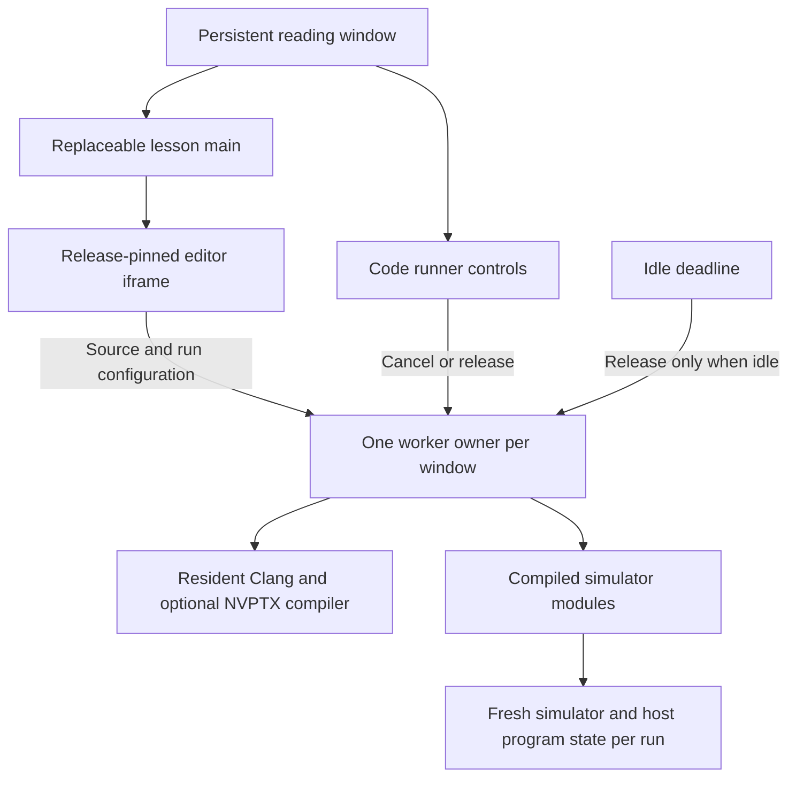

# Reusable browser code runner for static labs

This design keeps CUDA C++ Lab’s compiler warm between lessons while allowing the
learner to release its memory. It is a reference implementation for other labs,
not a shared package. It complements the [offline/update design](offline-update-design.md):
saved course files and a running WebAssembly toolchain have different lifetimes.

## Learner contract

- **Compile and run** starts the runner automatically. A separate startup step is
  unnecessary. **Start code runner** can prepare it without executing the program.
- The header shows **Stopped**, **Starting**, **Compiling**, **Running** or **Ready**.
  **Ready** means the execution tools are resident in this reading window; it does
  not establish that the whole course has been saved offline.
- **Stop run** cancels the active operation. **Stop startup** cancels a manual
  preparation before any program is executed. **Free memory** terminates the idle
  worker. Both keep editor text and previous results. Neither deletes downloaded
  files, drafts or manual completion marks.
- Five minutes without a run releases the worker. The idle interval starts after
  an operation finishes. A running compile/simulation is never cancelled by the
  idle policy; the separate execution deadline still applies.
- The first run explains device CPU/RAM use, reuse, idle release and the header
  control, beside the editor. It does not interrupt the task with a modal or
  require the learner to understand WebAssembly. Later lessons omit that introduction.
- Each run receives fresh simulated program state. Compiler reuse must never
  carry simulated allocations, streams, events, output or errors into another run.

The browser can suspend timers or discard a tab. The idle deadline is best effort,
checked again on focus and visibility changes. A browser cannot promise that a
runtime will survive backgrounding or release physical RAM at an exact second.
When a worker ends, its WASM heaps become reclaimable; the browser controls actual
memory reclamation. The next run starts the tools again.

## Why a persistent reading document

A dedicated worker belongs to its document. Normal full-page navigation destroys
that worker. Cached compiler files avoid a network transfer but do not preserve
an instantiated compiler or its heap. A service worker may be terminated by the
browser and must not host long-running compilation. SharedWorker lifetime/support
must not be the sole guarantee for a mobile reading session.

CUDA C++ Lab therefore enhances ordinary links with same-document navigation while
the runner is resident. The top-level document, header, App status and worker stay
alive; the next lesson replaces `main`, remounts its controllers and creates its
normal release-pinned editor iframe. Static HTML, ordinary links and no-script
reading remain available. Reload, a new tab, unsupported navigation or a different
release uses a complete page load and a cold runner. A memory release also permits
subsequent links to take the ordinary page-load path.

A mature lab should change lessons infrequently. Most navigation then reuses one
release and one resident toolchain. During active development, crossing releases
will cause more cold starts. Do not hide new online content to improve a benchmark,
or retain incompatible execution assets across releases.

This is one owner per reading window, not a global singleton across tabs, browser
profiles or labs. Different tabs can run independent experiments without stealing
one another’s jobs. Multiple tabs that run code can each consume memory.

## Lifecycle and message ownership

| State | What is resident or executing | Available action |
| --- | --- | --- |
| Stopped | No runtime worker; lightweight configuration may remain | Compile and run, or Start code runner once an editor has supplied its configuration |
| Starting | Verified execution assets are loading/initialising | Stop run, or Stop startup for manual preparation |
| Compiling | Current editor text is being compiled | Stop run |
| Running | Compiled host code and GPU simulation are executing | Stop run |
| Ready | Compiler/module caches remain, no active job | Compile and run, or Free memory |

One active job owns its reply callback. Reject competing submissions without
replacing that job. Detaching a finished editor must not terminate the shared
worker. Detaching an editor with an active job cancels that job. Explicit stop,
startup/runtime errors and timeout terminate the worker and clear timers. Late
messages from a terminated worker are ignored by worker identity. Compilation
errors retain the usable compiler; the editor distinguishes compiler failures,
program-written checks and ordinary changed results.

The embedded client waits for the matching parent owner rather than starting an
accidental second runtime during a slow page load. Only a same-origin editor with
the same release ID attaches. A standalone workbench owns its own runner. Source
editing remains read-only until starter/draft restoration hooks finish loading.

Opening lessons and later architecture lessons use different simulator adapters.
Cache their compiled WASM modules separately and load a later adapter only when
needed. Both reuse Clang. Restore the appropriate CUDA header shim before each
compilation, including when returning to an opening lesson. Create a fresh
simulator instance and host program instance for every run.

## Navigation, saved work and updates

Save the outgoing parent and editor state before requesting a replacement and
again immediately before committing it. The second check covers edits or a run
started while HTML is arriving. Respect composition, storage, completion-mark and
restart guards. A failed guard keeps the current lesson intact. Read-only editors
that have not initialised cannot contain new edits and need not block navigation.

Abort an in-flight lesson request when the document leaves or reloads, and reject
its stale continuation. It must not later replace content in a resumed document.

History changes the URL before `popstate` runs. Keep the outgoing reading route
explicitly so its snapshot cannot be stored under the destination’s key. Remount
model, recording and completion controllers once; pause outgoing media; clear stale experiment hooks;
restore results without rerunning code. Keep Back/Forward scroll positions and
move keyboard focus to the new heading. Guarded history transitions return to the
outgoing history entry. Rebase main-content links against the requested normal
lesson URL, and keep shared chrome URLs absolute when moving between `/` and `/v2/`.

Same-document navigation is still an **online navigation**, not an immutable
same-release asset fetch. It must request current published HTML, preserve genuine
404s, and fall back to verified saved HTML offline. The worker implements the same
routing/verification rules for GET requests marked `X-Lab-Navigation: 1`, and echoes
that header on its response. If a controlling older worker does not acknowledge
this contract, the client uses ordinary full-page navigation. Never let an old
worker’s cached page silently masquerade as the latest online lesson.

The response must contain the expected course shell marker, main region and the
same release ID before its main can be adopted. Different releases require a full
page load, preserving drafts through the existing state protocol. Metadata checks
do not automatically replace an open lesson or instantiate a toolchain. Explicit
**Restart to update** still guards every participant and reloads the complete
window; it must wait for or explicitly stop active compilation/simulation.

All runner modules/styles and both execution adapters are included in the complete
release manifest. A successful saved course can start a cold runner offline. RAM
being warm is an optimisation, never a condition for offline readiness.

## Implementation map

| File | Responsibility |
| --- | --- |
| [src/code-runner.mjs](../src/code-runner.mjs) | Worker ownership, serial jobs, cancellation, deadlines and idle release |
| [src/code-runner-host.mjs](../src/code-runner-host.mjs) | Parent owner, header/dialog, restart guard and visibility checks |
| [src/code-runner-client.mjs](../src/code-runner-client.mjs) | Same-release editor attachment, first-use guidance and worker facade |
| [src/course-session.mjs](../src/course-session.mjs) | Same-release navigation, URL handling, state guards, remounting and history |
| [src/experiment-state.mjs](../src/experiment-state.mjs) | Existing snapshots plus explicit reading-route context for remounts |
| [content/v2-warm-toolchain.mjs](../content/v2-warm-toolchain.mjs) | Build-time extension of the vendored worker’s compiler/adapter cache |
| [src/code-runner.css](../src/code-runner.css) | Compact header status and accessible controls using the existing palette/type |

Keep worker transformation assertions and real basic → advanced → basic execution
checks when updating the vendored toolchain. The cache is an internal optimisation;
never rewrite a learner’s source to obtain a cached result.

## Verification and adaptation

Before porting, inventory controller mount/dispose hooks, editor ownership, run
messages, version pins, snapshot keys, routing and restart guards. A lab without
safe remounting should retain ordinary navigation until those contracts exist.
Do not copy this router into an application with different link or state semantics.

Verify these journeys using real workers and real code:

- Cold run, same-editor repeat, Next, a different adapter, return and Back/Forward:
  one worker/compiler, correct outputs, fresh program state and retained edits.
- Manual preparation executes no learner code; release/restart keeps results.
- Stop while downloading, compiling and running; timeout/crash; a late old reply;
  another submission while busy; each can recover with the next run.
- Idle release, activity resetting its deadline, delayed background timers and a
  running operation crossing an idle deadline.
- New tab, reload, full page load, missing runtime APIs and a blocked owner startup.
- New published HTML while an older version is saved; genuine 404; unreachable
  host; verified/corrupt offline HTML; old worker without navigation acknowledgement.
- Composition or denied snapshots, new edits while HTML arrives, completion marks,
  model results, recording position, relative links, keyboard and six layouts/themes.
- Save the complete course, close the browser, disable network, open an unvisited
  lesson and compile with a cold runtime. An already-warm heap cannot prove this.

Measure cold startup, same-page repeat, next-lesson startup and adapter upgrade
separately. Record compiler asset requests and worker initialisations as well as
wall time. Do not assert a universal speed ratio from one machine’s timings.
The integration suite records timings under `test-results/code-runner/timings.json`;
unit tests exercise deterministic lifecycle/race cases. Functional tests and
simulator timings do not establish learning effectiveness or physical GPU speed.

## Initial timing observation

A single Chromium 145 headless run on the Linux development workspace, served over
local HTTP, recorded these wall times from clicking Compile and run to the enabled
button/result. The initial implementation also exercised the first-use guidance.
These samples are not a device-independent benchmark or a GPU measurement.

| Journey | Previous page-owned worker | Persistent runner |
| --- | ---: | ---: |
| First lesson, cold run | 7.089 s | 8.092 s |
| Same lesson, repeat | 1.030 s | 2.064 s |
| Next lesson, first run | 9.107 s | 0.975 s |

The intended saving is next-lesson initialisation; this observation does not show
an improvement in cold startup or same-page compilation. The stronger regression
checks assert one worker across navigation and no repeated compiler asset requests.
The first upgrade to the later adapter took 3.016 s, and returning to the opening
adapter took 1.022 s in the same run. Use multiple samples on representative mobile
and desktop devices before making a general performance claim.
