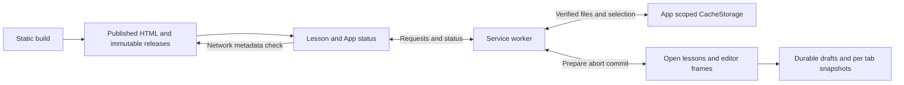
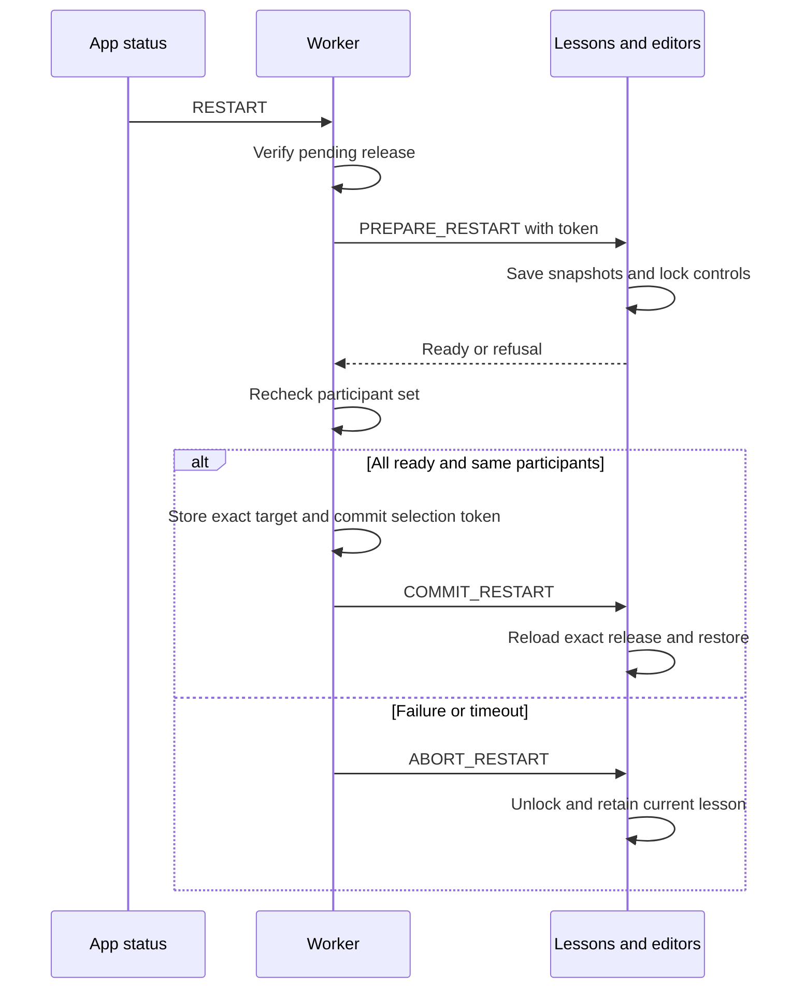

# Reusable offline and update design for static labs

Static labs should open current published pages when connected, keep an active
lesson stable, and provide a complete verified course when the learner explicitly
saves it. Saving a replacement must preserve the previous usable copy and learner
work. A metadata check, an installed shortcut and a few cached pages do not establish
offline readiness.

This design describes the CUDA C++ Lab implementation, including the persistent
[code runner lifecycle](code-runner-design.md). The original offline reliability
work is recorded in [PR #185](https://github.com/snowch/cuda-cpp-lab/pull/185).
It is a reference for adapting the mechanism to other labs, not an extracted shared
package. [App status and release lifecycle](app-status.md) records the CUDA C++ Lab
configuration and compatibility history. Product-specific names, storage keys,
editor hooks and manifest contents must be adapted together.

## Behaviour promised to learners

- Normal online navigation and reload open the published course without requiring
  a full download. An already-open lesson is not automatically reloaded.
- **Save offline copy** saves all required lessons, recordings, diagrams, examples
  and browser execution dependencies, including content never visited.
- **Downloaded and ready to use offline** appears only after the complete saved
  release passes verification. A transfer reaching 100% is not sufficient.
- **Update offline copy** saves a replacement using the same verified transfer.
  A separate download action or second offline opt-in is unnecessary.
- **Restart to update** selects a prepared replacement after saving and guarding
  every participating window. Failed or cancelled replacements keep the previous
  verified selection usable. A prepared first copy may also require this restart
  when an older partial selection already exists.
- Cancelling keeps verified files for explicit resume and stops automatic retry.
  Removing course files preserves learner work, preferences and sibling labs.

The guarantee applies to files stored in this browser profile. Browser eviction,
user removal or profile loss can invalidate it. Request persistent storage on an
explicit save where supported, reverify availability, and never retain a permanent
“ready” flag as a substitute for inspecting the saved files. Offline use requires
HTTPS or localhost, storage access and a controlling service worker. External links
and separately installed desktop tools remain outside the course download.

## Self-hosted dependency boundary

All files needed to read or run a course must be published inside that lab's own
project scope. This includes lazy-loaded packages, fonts, workers, WebAssembly,
compiler support, recordings, emulator firmware, Linux kernels and guest images.
A third-party iframe, CDN fallback or another lab's runtime directory is a missing
release dependency. Do not claim complete offline access while execution still
requires any of them. Optional external documentation links and separately installed
desktop tools are outside the saved course; label those destinations clearly.

The build may fetch pinned upstream packages with verified checksums. Bundle the
runtime files and their licence/source obligations in the published release. Include
all transitively loaded files in the manifest, even if the learner has never opened
the associated tool. Updates must retain files needed by active previous clients;
self-hosting does not remove the release-retention contract below.

Release verification must block requests outside the project scope and exercise a
cold runner, the first compilation, package-dependent examples, embedded tools and
lazy media. Then save the complete release, disable the network, open an unvisited
lesson and repeat execution. Inspect service-worker, worker and iframe requests as
well as the top-level page. Record the tested journeys and limitations; loading the
homepage without third-party requests does not establish course completeness.

## Separate the four identities

| Identity | Meaning | Changes when |
| --- | --- | --- |
| Running document | The version of this page and its executable assets | A same-release lesson swap retains the document; navigation to another release, reload or explicit restart opens a complete matching document |
| Published release | The last successfully checked deployment manifest | A fresh network metadata check succeeds |
| Saved selection | The release chosen for offline navigation, plus its verified availability | First save or an explicit coordinated restart selects it; missing files can invalidate availability |
| Installed worker | The code handling requests and the lifecycle protocol | The browser installs and activates a worker update |

These identities can legitimately differ. New online HTML does not prove that a
new worker controls the tab. A newer published release does not invalidate a
complete older offline copy. Closing windows can permit worker activation, but
must not silently select a pending course replacement.

Use a content-derived release ID rather than the Git branch head. The commit and
date are provenance; the release ID identifies the actual built files. Keep the
worker protocol compatible independently of the course release.

## Components and ownership

The build defines the complete release. The page renders online freshness and
offline availability without conflating them. The worker owns file verification,
download requests and saved selections. Each lesson or embedded editor owns its
learner state and must acknowledge a successful snapshot before restart.

| Reference implementation | Responsibility |
| --- | --- |
| [scripts/offline.mjs](../scripts/offline.mjs) | Build manifest, immutable copies, page metadata, pinned URLs and App status markup |
| [src/release-contract.mjs](../src/release-contract.mjs) | Shared manifest validation and SHA-256 |
| [src/release-metadata.mjs](../src/release-metadata.mjs) | Published metadata cache-age validation |
| [scripts/service-worker.js](../scripts/service-worker.js) | Scoped storage, routing, verification, transfers, restart and cleanup |
| [src/offline.mjs](../src/offline.mjs) | Dialog state, checks, worker RPC, progress, resume and compatibility |
| [src/experiment-state.mjs](../src/experiment-state.mjs) | Reading snapshots, restart guards and restoration |
| [src/v2-workbench-state.mjs](../src/v2-workbench-state.mjs) | Example of lab-specific embedded editor state |
| [src/media-range.mjs](../src/media-range.mjs) | Byte-range responses for saved recording playback and seeking |

## Release and hosting contract

Generate one validated `release.json` containing `schema`, `id`, nullable
`commit`/`date` provenance, aggregate `bytes`, and sorted `files` entries with
app-relative `path`, `bytes` and `sha256`. Reject duplicate or escaping paths,
reserved lifecycle paths, invalid hashes and inconsistent totals. Include every
runtime dependency: lazy modules, fonts, captions, posters, workers, Wasm, compiler
data and source downloads. Do not claim a complete course if a later button still
needs an unlisted network dependency.

The hashes establish consistency with the trusted manifest, including detection
of incomplete saves and mixed deployments. They are not a signed release system;
manifest authenticity relies on the HTTPS origin and deployment access controls.

Publish normal HTML routes, a stable `sw.js`, `release.json`, and immutable
`releases/<id>/` copies together. In CUDA C++ Lab, the ID hashes the worker source and
the sorted generated files containing a build-ID placeholder; substitute that ID
before calculating the final per-file hashes and byte counts. The generated
manifest and worker are excluded from their own file list, avoiding self-hashing.

Pin each document's scripts, styles, media and example downloads to its immutable
release. Pin embedded documents as well; CUDA C++ Lab uses `gpu-release` in their query
string to retain their normal base URL. Relative module imports must still resolve
correctly after any verified response is recovered from a different network URL.

Publish atomically and never change bytes under an immutable release URL. If the
host removes old release directories, an old missing file can be recovered from
the live root only when it still matches that old manifest's size and hash.
Changed bytes must not be mixed into an open older lesson. Retaining previous
immutable releases on the host improves repair availability; it does not replace
client-side verification.

Published metadata is network-only, including through the worker. Use bounded
requests, cache-busting, `cache: no-store`, response validation and rejection of
late results. Explicitly account for the host's CDN: CUDA C++ Lab accepts a positive
`Age` only within an explicit `max-age` of at most 600 seconds and below that
lifetime. This bounds freshness; it cannot defeat an intermediary that lies about
its headers. The immutable running manifest needs integrity validation, not the
same freshness check. A failed check clears the offered published version without
hiding independently verified offline availability.

## Routing rules

| Request | Rule |
| --- | --- |
| Ordinary top-level navigation, acknowledged same-document lesson navigation, or reload | Try the network with a deadline and buffer HTML within it; on a connection failure or server error, fall back to the selected saved release |
| Genuine online 404 | Preserve the 404 instead of reviving a retired saved page |
| Explicit release asset or pinned editor | Use that release; never fall through to unrelated live bytes |
| Coordinated restart navigation | Open the exact verified transaction target, even if another deployment has appeared |
| Root or immutable release metadata | Network-only; do not serve stale cached deployment metadata |
| Saved media range request | Return the correct range from the cached complete response |

Same-document lesson navigation sends `X-Lab-Navigation: 1` on its normal-URL
GET. Handle it with the same fresh-online/verified-offline HTML rules as a native
navigation, including buffering, deadlines and genuine 404s. Echo the header to
acknowledge support. A client controlled by an older worker without this response
marker falls back to native navigation. Treat this as a compatible extension, not
a reason to activate a waiting worker automatically.

Adopt returned lesson content only when the release ID and shell marker match the
running document. Otherwise perform normal full-page navigation. Resolve relative
links against the **requested normal lesson URL**: a cached response can carry an
immutable response URL that would otherwise double the release prefix. Track the
outgoing route separately from browser history when saving state during Back/Forward.

A warmed WASM compiler uses CPU/RAM and is independent of downloaded course files.
**Code runner: Ready** does not mean downloaded; **Downloaded and ready to use offline**
does not mean a runtime is resident. Freeing RAM or idle shutdown preserves saved
files and drafts. The runner defaults to a 30-minute idle interval, configurable
in its header controls; this preference does not change offline retention. Its
allocated-WASM memory reading is unrelated to downloaded file size. Include all runner modules, styles and lazy execution adapters in
the manifest so offline execution can start cold. A busy runner participates in
restart guards; matching-release swaps reuse it, full release changes recreate it.

Visited-page retention is an optimisation, not a full save or offline consent.
Only already-loaded page resources are eligible; no worker installation or
metadata check downloads the full course. Optional retention must yield to an
explicit save. Its failures must not prevent normal online reading.

Missing or corrupt top-level offline HTML receives a self-contained recovery page
with safe return/retry controls and guidance appropriate to unsaved, damaged,
pending-update or unknown-route state. Core recovery must work without cached
scripts, fonts or styles. Never cache recovery HTML over a lesson or return it as
JavaScript, CSS or Wasm. A recovery tab must also participate safely in restart.

## Stored state and transfer lifecycle

Keep app-scoped selection metadata separate from each release's file cache and
from learner work. Derive the namespace from both an app identity and the exact
registration base URL so cleanup does not remove sibling labs' files on the same
origin. CUDA C++ Lab uses these selection fields:

| Field | Purpose |
| --- | --- |
| `active`, `saved` | Selected offline release and intent to retain a complete copy; `saved` alone is not proof of completeness |
| `previous` | Previous selected release retained across replacement |
| `pending`, `pendingSaved` | Verified replacement awaiting explicit restart and its offline intent |
| `partial` | Release with resumable files |
| `visited` | Recently retained online release, which may be incomplete |
| `restartToken` | Binds selection to the exact restart navigation record |

A separate persisted download request records its unique ID, release, initiating
running version, mode, consent (`wanted`), stage, progress and error. This lets a
reopened page recover the same request without starting competing jobs.

1. On an explicit save/update/repair, request persistent storage where supported.
   Permission denial must not block the normal verified save path.
2. Reserve the mutation operation before waiting for cleanup. Reuse files that
   already pass size and SHA-256 verification; request only missing/invalid files.
3. Use native Background Fetch when available. Import its responses into the
   release cache only after validating each one. API presence is not permission
   or successful execution; handle native startup failure with the same resumable
   foreground request.
4. In the foreground path, persist progress and consent. The browser may pause
   work when hidden or closed; resume a previously authorised request on return
   or reconnect. Do not promise uninterrupted background execution on every browser.
5. After transfer, reverify the complete manifest before marking the job ready or
   updating selection metadata. Distinguish transferred bytes from verified bytes.
6. Select a first saved copy immediately only when no different selection needs
   preserving. Otherwise store it as `pending`; expose explicit restart.

### Native download stalls

API support does not guarantee progress. In C Foundry, a real Chromium download
stopped at exactly 222.7 MB of 242.6 MB after both three and six minutes. A longer
test timeout did not repair the transport. A visible online page needs a bounded
no-progress watchdog and a foreground handoff for the same persisted request.

The tested adapter waits 45 seconds without byte progress, records a per-job
`foregroundOnly` flag, aborts the native registration, imports completed responses
that pass the release path, byte-count and SHA-256 checks, and resumes missing
files through PREPARE. The handoff preserves the existing job ID and download
consent. Explicit Cancel still revokes consent. Unresolved native response
promises have a bounded wait (ten seconds in this adapter); incomplete or invalid
aborted responses are retried, never accepted as verified files. Join concurrent
completion-event and handoff imports for a registration. Keep the earlier
complete course usable until the entire replacement verifies.

Do not equate a native progress event or a transferred-byte total with completed
verification. Test the watchdog, partial response import, cancellation, retry and
earlier-copy preservation separately from a real full offline runtime journey.
See C Foundry's [protocol regression](https://github.com/snowch/c-foundry/blob/main/tests/background-protocol.cjs)
and [browser handoff journey](https://github.com/snowch/c-foundry/blob/main/tests/background-handoff.cjs).

Cancellation must persist `wanted: false` before aborting native/foreground work.
Late completion cannot revive that consent or select a cancelled replacement.
Quota and integrity failures need explicit attention; eligible connection failures
may resume the existing request. Keep completed verified files and the prior saved
selection across failures. Never use learner draft storage as download state.

Serialize cache mutations and coordinate pruning with transfers and restart.
Coalesce concurrent full verification scans only while they are in progress;
discard results afterwards. If navigation detects a damaged file during a scan,
invalidate that scan before it can report ready. Check file presence again after
hashing to detect eviction during a long scan. Bound parallel reads to avoid
loading all recordings into memory together.

## Coordinated restart and learner work

Treat restart as a guarded transaction, not a page refresh or worker activation.

Refuse restart for running experiments, input composition, incomplete experiment
initialisation, unsaved guards, unavailable snapshot storage or unresponsive
participants. Locks must have a bounded recovery timeout. Gate navigation during
the transaction and confirm the window set has not changed before committing.

Participant discovery must normalize every directory URL to its manifest HTML
path, not just the course root. For example, `/lessons/addition/` corresponds to
`lessons/addition/index.html`; a query or hash does not make it a different
document. Match the normalized pathname and origin against shipped HTML. Include
all lesson windows and define iframe ownership explicitly; exclude unrelated
documents and other origins.

A root-only SPA fixture cannot verify this rule. RISC-V's two-lesson browser test
caught an implementation that skipped directory-based lesson windows entirely.
It could select the update without saving or reloading those windows and then
show Restart again. The regression blocks snapshot storage in one of two
different lesson directories, requires a refused transaction with an explanation,
then enables saving and requires both windows to restore into the same new
release.

Store the exact reload target with participating navigation IDs and a token also
stored in selection metadata. A ticket without a matching committed selection
must not affect navigation. This is a guarded multi-step commit, not an atomic
transaction across all CacheStorage records and tabs. It must survive worker
process termination. Later ordinary visits return to network-first routing.

Lessons register serialisable save/restore hooks for controls, visual selections,
results, trace positions and exercise state. Retain durable editor drafts
independently. Save per-tab snapshots for reading position, disclosures and focus;
exclude release pins and transient status-opening flags from snapshot keys.
Ordinary navigation restores values while honouring the requested anchor and
history position. Never rerun an experiment automatically to manufacture restored
output. If restoration fails, retain an exportable snapshot.

Define who reloads embedded editors: CUDA C++ Lab's parent lesson owns that reload,
avoiding a frame consuming its snapshot before the replacement parent creates it.
Porting requires hooks for each lab's actual editors and experiments; copying the
dialog and worker alone cannot preserve learner work.

## Status presentation

Keep one **Course status** section and one primary action. Derive presentation
from online-check, saved-copy, transfer and pending-restart states together; a
single `upToDate` Boolean cannot express them.

| Situation | Visible information and primary action |
| --- | --- |
| Published version matches page; no complete saved copy | **Up to date online. Not saved for offline use.** → **Save offline copy** |
| Complete current copy; published version matches | **Up to date. Downloaded and ready to use offline.** No save action |
| Page is current online; complete saved copy differs | State that the offline copy is a different version and remains available → **Update offline copy** |
| Published version is newer | **Update available**, plus any verified saved-copy availability → **Save offline copy** or **Update offline copy** according to existing intent |
| Transfer running or paused | Stage, meaningful progress and pause/error information; expose **Cancel download** while applicable |
| Relevant prepared replacement is verified | **Update downloaded and checked** → **Restart to update**; **Later** dismisses without clearing pending state |
| Saved current copy is incomplete | Explicit incomplete status → **Repair offline copy**; a newer published release can instead offer an update |
| Metadata check fails | Explain check failure, preserve verified offline availability and expose **Retry** without a stale update offer |

Do not offer an older pending release as the update target when a newer published
version is known. Keep version/build inspection, manual checking, installation
help and confirmed removal in optional details. Label byte totals as package size,
not evidence of completion; use consistent units. Distinguish **Clear saved files**
for partial retention from **Remove offline copy** for verified copies. Preserve
keyboard focus when actions disappear, label progress and status regions, and
review phone, tablet, desktop and both themes.

CUDA C++ Lab checks on opening, focus, reconnect and return to visibility with a
15-second throttle, and once a minute while visible and connected. Manual checks
bypass the throttle. Abort or ignore stale responses, deduplicate checks and do
not use `navigator.onLine` as evidence that a deployment is reachable.

## Worker upgrades and cleanup

Do not use unconditional `skipWaiting` or confuse worker activation with selecting
a course update. Support older pinned pages talking to newer workers and current
pages talking to an older installed worker. Version incompatible protocols and
migrate explicitly. Exercise actual former clients/workers, not just mocks of the
latest messages. Existing windows may need to close once before a waiting worker
can take over; wait for installation before testing that transition.

Recognise a complete existing copy only through verification. Recognition must not
download missing files, infer consent from a partial visited cache, replace a
pending/resumable selection or restart into an unrelated old release.

Cleanup keeps selected, previous, pending, resumable, recently visited and open
document versions, plus legacy copies awaiting migration. Defer pruning until
arriving windows identify their release. Confirmed removal deletes only this
app's caches and unregisters only this registration; never clear localStorage,
sessionStorage or sibling app registrations.

## Porting to another lab

1. Inventory all shipped and lazy runtime dependencies and establish atomic
   deployment, immutable release paths and the host's metadata caching policy.
2. Adapt the build and shared validator together. Keep normal routes and pinned
   asset/editor URLs correct at both the origin root and the lab's subpath.
3. Set the registration scope, app namespace, metadata markers, release query,
   event names, download notification text and icons. Migrate existing namespaces
   deliberately instead of resetting installed users.
4. Integrate the page/worker protocol as a unit. Current operations are `STATUS`,
   `REMEMBER_PAGE`, `DOWNLOAD_PLAN`, `BACKGROUND_STARTED`, `PREPARE`, `CANCEL`,
   `RESTART` and `REMOVE`; replies carry result/error or progress. Restart uses
   `PREPARE_RESTART`, `ABORT_RESTART` and `COMMIT_RESTART` with tokens. Broadcasts
   include status/progress, removal and requests to open App status. Preserve
   compatibility fields used by older clients when adapting them.
5. Add and migrate each experiment's save/restore hooks, durable drafts, busy
   guards, iframe ownership and snapshot schemas before enabling restart.
6. Reuse the state distinctions and acceptance journeys below. Adapt fixtures to
   the receiving lab's largest assets and real execution tools; do not treat CUDA C++
   Lab's Chromium results as validation of another lab or platform.

## Acceptance tests before reuse

Use independently built releases and real browser workers, CacheStorage and HTTP
responses. Test the state machine deterministically as well as complete browser
journeys. Storage exceptions, denied persistence and unavailable APIs are expected
conditions. The essential journeys are:

| Journey | Required result |
| --- | --- |
| First visit, no full save, disconnect, Next/Back/retry/reconnect | Never claim ready; usable recovery; edited work retained; no unconsented full download |
| Save, close browser, deny host before cold launch, open unvisited lessons | Correct saved release, working Next/Back/reload and new tab, real execution and recording playback |
| Interrupt or cancel before a future lesson is stored | No false readiness; verified partial files reused; cancellation stays cancelled |
| Close/hide page during native and foreground transfers | Native path completes when supported; fallback resumes consented work without competing jobs |
| Update fails, exceeds quota or receives wrong bytes | Prior saved release still usable; accurate error and explicit recovery |
| Evict/corrupt a lesson, including during another verification scan | Readiness invalidated; no corrupt HTML or stale ready result; explicit repair preserves work |
| New online release with an older complete saved copy | Current online reads through both native and same-document navigation, stable open tabs, older offline navigation and current content after reconnect |
| Prepared update while another deployment appears | Explicit restart opens the exact verified target and restores all participating work |
| Two directory-based lesson URLs, explicit `.html`, root, query/hash variants and unrelated documents | All course windows save and reload; a blocked save in either lesson vetoes selection; unrelated windows are untouched |
| Native transfer stops reporting byte progress while a page is visible and online | Same consented job hands off; verified partial files reused; unresolved native records cannot block indefinitely; prior complete copy remains usable |
| Busy/unresponsive tab, composition, denied snapshots or arriving window | Whole restart refused safely; controls unlock; no selection change or lost inputs |
| Older worker without same-document navigation support | Native navigation fallback, fresh online HTML and retained work |
| Actual older installed worker/client and complete-cache recognition | Compatible migration, no download loop or premature activation, preserved files/consent/drafts |
| Metadata timeout, stale CDN response, late result or offline check | No misleading freshness or stale update action; saved availability remains independent |
| Remove one lab with partial/complete copies and sibling apps present | Confirmed scoped deletion; learner storage and sibling apps unchanged |

For the plane test, block the whole browser's network before launch. Page-level
offline emulation alone can let a cold worker reach the server and falsely pass.
Use a refusing proxy or an unreachable test host in addition to browser emulation.
Perform a public-deployment check from an existing installation as well as local
fixtures. Verify actual save/ready state, route responses, edits, outputs and media,
not just that the dialog contains the expected words.

Reference suites: [manifest/build](../tests/offline.test.mjs),
[worker routing and races](../tests/worker-navigation.test.mjs),
[online transitions](../tests/online_navigation.py),
[learner journeys](../tests/offline_journeys.py),
[background downloads](../tests/offline_background.py),
[complete course and cold startup](../tests/offline.py), and
[interface and keyboard behaviour](../tests/browser.py).

The reference was verified with Chromium, including the public cold offline
journey. Native installation prompts, physical Android lifecycle/storage behaviour
and Safari/iOS need their own platform checks before making equivalent claims.

## Runtime assets and older open tabs

Retain two previous immutable release trees at publication, including original compiler/runtime archives and manifests. Verify original byte hashes; retention failure blocks deployment. Keep archive timestamps reproducible. An old tab may not start its compiler until after a newer version is published, so testing only an already-warm compiler misses this lifecycle. Do not substitute a newer archive merely because its extracted files look equivalent. Retained trees do not increase the current course download manifest. Both CUDA labs and C++ Foundry use this publication rule.

## Missing runtime files are infrastructure failures

Classify missing, failed, corrupt or incompatible runtime downloads separately from compiler diagnostics and program checks. Preserve the last genuine result and identify it as previous output. Show a persistent native alert dialog with a dimmed backdrop, **Reload lesson** and **Stay on lesson**. Escape stays on the lesson and returns focus. Never auto-dismiss or stack it over another modal. Keep download diagnostics optional and an inline recovery control available after Stay. The common `src/runtime-recovery.mjs` component accepts a course-specific save guard and run-control label.

Explain that reload needs an online connection and saves work first. Save source, predictions, selected cases, results, disclosures and scroll before navigation. Cancel reload if any save fails or a run is active; keep the lesson open and explain the failure inside the modal. Reload must never automatically execute learner code. Ordinary compilation/execution errors remain beside the editor, and valid output changes do not fail an original-example comparison.

Verify old-tab first Run after a deployment, startup from the header, runtime failure after a previous successful result, Stay/Escape/focus and keyboard trapping, storage-blocked reload, safe reload and edited rerun. Also test true offline navigation in a fresh tab, interrupted download, return online, busy/multiple tabs, restart and removal. A passing compiler test alone does not verify offline readiness or learning effectiveness.
